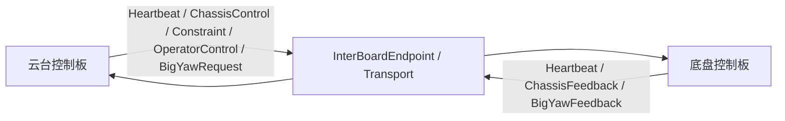

# 底盘与云台板间通信协议（v4）

本文是本工程板间通信的**协议主文档**。协议内容按 SkyWalker 双主控 v4 业务协议整理，统一描述云台控制板与底盘控制板之间的业务帧、消息语义、时效保护和物理传输选择。

> **实现边界（本地工程）**：本文替代旧的 USART10 V1/V2 说明。当前本地已经实现 v4 固定头、CRC、流式 Parser、七类 payload 编解码，以及底盘侧 Heartbeat/ChassisControl/BigYawRequest 接收和 Heartbeat/ChassisFeedback/BigYawFeedback 发送；旧 V1 接口仅为现有迁移测试保留。云台侧发送端、真实双板收发和硬件联调仍待完成。

协议参考：

- [SkyWalker 通信层](https://shm-white.github.io/SkyWalker_General_Embedded_Code/docs/architecture-browser/#read/docs/modules/communication/communication.md)
- [SkyWalker 板间 UART、RS485 与 CAN](https://shm-white.github.io/SkyWalker_General_Embedded_Code/docs/architecture-browser/#read/docs/modules/communication/interboard-transports.md)
- [SkyWalker 双主控板间通信接口](https://shm-white.github.io/SkyWalker_General_Embedded_Code/docs/architecture-browser/#read/docs/api/interboard.md)

## 1. 协议职责与数据流

云台板负责产生操作、底盘运动和大 Yaw 请求；底盘板负责接收、校验、检查时效并执行底盘和大 Yaw 控制。底盘状态、反馈和心跳反向发送给云台板。



业务层只使用 `InterBoardEndpoint` 的值接口；物理层可以选择 UART、RS485 或经典 CAN。业务帧格式和消息 ID 不随物理后端改变。

## 2. 坐标系与速度语义

v4 的 `ChassisControl` 和 `BigYawRequest` 发送的是底盘执行器使用的目标量：

| 量 | 定义 | 单位 |
|---|---|---|
| `vx` | 车身 `+X`，车头方向 | m/s |
| `vy` | 车身 `+Y`，车左方向 | m/s |
| `wz` | 俯视逆时针旋转 | rad/s |
| `target_rate_rad_s` | 大 Yaw 目标角速度 | rad/s |

车身坐标固定为 `+X` 向前、`+Y` 向左、`+wz` 逆时针。四舵轮解算直接消费车身坐标速度。当前云台遥控转发的 `vx/vy` 采用云台坐标，由底盘使用大 yaw 绝对编码器反馈和固定车头零位转换为车身坐标；相对角不从 v4 控制帧推导。UART7 主机输入仍为车身坐标。其他场地坐标输入需先完成对应坐标转换。

## 3. v4 业务帧格式

每个业务帧均使用下面的固定头部、可变 payload 和 CRC：

| 字节 | 字段 | 类型 | 说明 |
|---:|---|---|---|
| 0 | `SOF0` | `uint8` | `0xA5` |
| 1 | `SOF1` | `uint8` | `0x5A` |
| 2 | `version` | `uint8` | 固定 `0x04` |
| 3 | `sender_role` | `uint8` | `1=GimbalController`，`2=ChassisController` |
| 4..5 | `message_id` | `uint16 LE` | 消息 ID |
| 6..7 | `payload_length` | `uint16 LE` | 0～128 字节 |
| 8..11 | `frame_sequence` | `uint32 LE` | 发送端通信帧序号 |
| 12.. | `payload` | bytes | 业务载荷 |
| 末尾 2 字节 | `crc16` | `uint16 LE` | 覆盖字节 0 至 payload 末尾 |

完整帧长度为 `14 + payload_length`，最大 142 字节。未知版本、未知消息、非法长度、非法角色、CRC 错误和不符合消息方向的帧必须拒收。

### 3.1 CRC-16/CCITT-FALSE

| 参数 | 值 |
|---|---|
| 多项式 | `0x1021` |
| 初始值 | `0xFFFF` |
| 输入反射 | 否 |
| 输出反射 | 否 |
| 最终异或 | `0x0000` |
| 覆盖范围 | 帧头、版本、角色、ID、长度、序号和 payload |
| 存储顺序 | 低字节在前，高字节在后 |

浮点字段使用 IEEE-754 `float32`，按小端字节序打包。不能直接 `memcpy` C 结构体作为线上报文，必须按字段偏移打包。

## 4. 消息 ID 与 payload

### 4.1 Heartbeat：`0x0001`，双向，20 字节

| Payload 偏移 | 字段 | 说明 |
|---:|---|---|
| 0 | `role` | 必须与帧头 `sender_role` 一致 |
| 1 | `safety_state` | 发送板安全状态 |
| 2 | `ready` | 发送板是否准备就绪 |
| 3 | `sync_requested` | 是否请求同步运行状态 |
| 4..7 | `active_reasons` | 安全原因位掩码 |
| 8..11 | `sender_uptime_ms` | 发送板启动后的运行时间 |
| 12..19 | `sender_boot_id` | 本次启动唯一身份 |

### 4.2 ChassisControl：`0x0101`，云台 → 底盘，32 字节

| Payload 偏移 | 字段 | 说明 |
|---:|---|---|
| 0 | `mode` | `Disabled`、`BodyVelocity` 或 `Spin` |
| 1 | `source` | 控制来源 |
| 2 | `global_action` | 全局安全动作 |
| 3 | 保留 | 必须为 0 |
| 4..7 | `vx_m_s` | 车身前向速度 |
| 8..11 | `vy_m_s` | 车身左向速度 |
| 12..15 | `wz_rad_s` | 底盘逆时针角速度 |
| 16..19 | `active_reasons` | 安全原因位掩码 |
| 20..23 | `command_sequence` | 原始命令生产序号 |
| 24..31 | `receiver_boot_id` | 目标底盘本次启动身份 |

`vx/vy/wz` 必须为有限浮点数。接收端不得把通信重发当成新命令，也不得把电机 `ready` 状态反向作为发送新目标的门禁。

### 4.3 ChassisConstraint：`0x0102`，云台 → 底盘，20 字节

| Payload 偏移 | 字段 | 说明 |
|---:|---|---|
| 0 | `output_valid` | 输出许可数据有效 |
| 1 | `output_enabled` | 输出许可已启用 |
| 2 | `power_valid` | 功率约束有效 |
| 3 | 保留 | 必须为 0 |
| 4..7 | `power_limit_w` | 底盘功率上限 |
| 8..11 | `buffer_energy_j` | 缓冲能量 |
| 12..15 | `output_age_ms` | 输出许可原始年龄 |
| 16..19 | `power_age_ms` | 功率数据原始年龄 |

功率字段必须为非负有限值。预算数据不能伪装成实测功率。

### 4.4 ChassisFeedback：`0x0103`，底盘 → 云台，32 字节

| Payload 偏移 | 字段 | 说明 |
|---:|---|---|
| 0 | `execution_state` | 底盘执行状态 |
| 1 | `safety_state` | 底盘安全状态 |
| 2 | `ready` | 底盘是否准备就绪 |
| 3 | `armed` | 底盘是否允许输出 |
| 4..7 | `active_reasons` | 安全原因位掩码 |
| 8..11 | `last_command_sequence` | 最近执行的命令序号 |
| 12..15 | `valid_fields` | 反馈字段有效位 |
| 16..19 | `vx_m_s` | 实际/测量前向速度 |
| 20..23 | `vy_m_s` | 实际/测量左向速度 |
| 24..27 | `wz_rad_s` | 实际/测量角速度 |
| 28..31 | `power_w` | 实测功率 |

反馈有效位和 `ready/armed` 用于观测和诊断，不能替代命令自身的新鲜度检查。

### 4.5 OperatorControl：`0x0301`，云台 → 底盘，36 字节

| Payload 偏移 | 字段 | 说明 |
|---:|---|---|
| 0 | `run_allowed` | 允许运行 |
| 1 | `emergency_stop` | 急停 |
| 2..3 | 保留 | 必须为 0 |
| 4..7 | `source_sequence` | 原始操作源序号 |
| 8..11 | `source_age_ms` | 操作输入原始年龄 |
| 12..15 | `clear_event_id` | 清除事件编号 |
| 16..19 | `clear_event_age_ms` | 清除事件原始年龄 |
| 20..27 | `sender_boot_id` | 云台板本次启动身份 |
| 28..35 | `receiver_boot_id` | 绑定的底盘启动身份 |

`run_allowed` 与 `emergency_stop` 不能同时为真。清除事件必须结合发送方 boot ID 和事件编号一次消费，不能因重发重新绑定旧事件。

### 4.6 BigYawRequest：`0x0402`，云台 → 底盘，36 字节

| Payload 偏移 | 字段 | 说明 |
|---:|---|---|
| 0 | `mode` | `Disabled` 或 `FollowCenter` |
| 1 | `permission_valid` | 权限字段有效 |
| 2 | `permission_enabled` | 权限允许 |
| 3 | 保留 | 必须为 0 |
| 4..7 | `target_rate_rad_s` | 大 Yaw 目标角速度 |
| 8..11 | `source_sequence` | 原始目标序号 |
| 12..15 | `source_age_ms` | 原始来源年龄 |
| 16..19 | `command_age_ms` | 命令年龄 |
| 20..27 | `receiver_boot_id` | 底盘板本次启动身份 |
| 28..31 | `permission_age_ms` | 权限数据年龄 |
| 32..35 | `producer_sequence` | 生产者序号 |

底盘只接受本地接收年龄、`source_age_ms` 和 `command_age_ms` 都不超过 100 ms 的请求；`receiver_boot_id` 不匹配、权限失效或请求模式不是 `FollowCenter` 时撤销输出。云台板链路没有有效请求而 DT7 遥控器在线时，底盘板使用右杆 `ch0` 作为大 Yaw 的降级速度输入。

底盘侧大 Yaw 使用达妙 J4310 的 **MIT 力矩模式**，CAN 发送 ID 由速度模式的 `0x206` 改为 MIT 模式的 `0x006`。控制结构与云台 pitch 相同：

```text
BigYawRequest.target_rate_rad_s（或右杆 ch0）
    → 应用层积分成连续目标角（按 2π 归一，误差取最短分支）
    → 位置 PID：目标角误差 -> 目标角速度
    → 速度 PID：目标角速度误差 -> MIT 力矩
    → MIT 帧 given_torque，kp = kd = 0
```

MIT 帧不启用电机端位置/速度增益，闭环全部在底盘应用层完成。默认力矩限幅 3.0 N·m，位置/速度 PID 增益先沿用云台 pitch 量级，上板后必须按大 Yaw 实际惯量和负载重新整定。请求撤销、反馈超时、故障或清错期间先发零力矩再失能；使能后的最初几个周期保持零力矩，等反馈稳定后再进入闭环。

### 4.7 BigYawFeedback：`0x0403`，底盘 → 云台，24 字节

| Payload 偏移 | 字段 | 说明 |
|---:|---|---|
| 0 | `execution_state` | 大 Yaw 执行状态 |
| 1 | `ready` | 已准备 |
| 2 | `armed` | 已允许输出 |
| 3 | `valid` | 实际速度有效 |
| 4..7 | `actual_rate_rad_s` | 实际角速度 |
| 8..11 | `active_reasons` | 安全原因位掩码 |
| 12..15 | `last_command_sequence` | 最近命令序号 |
| 16..19 | `source_sequence` | 来源序号 |
| 20..23 | `production_age_ms` | 反馈生产年龄 |

## 5. 会话、序号和时效规则

1. 两端必须使用相同的 v4 版本；不做旧版本探测或兼容解码。
2. `frame_sequence` 是线上发送次数，不是业务目标生产序号；接收端拒绝重复和过旧帧。
3. 心跳中的 `sender_boot_id` 发生变化时，接收端清除旧控制、约束和反馈快照。
4. 重发同一个 producer sequence 时，不能刷新原始输入、命令或状态年龄。
5. 消息时间戳必须来自实际生产或接收时刻，通信线程不得用当前时间覆盖生产时间。
6. 心跳过期、目标板 boot ID 不匹配、原始输入过期、急停或权限撤销时，底盘必须撤销对应控制输出。BigYawRequest 的 `source_age_ms`、`command_age_ms` 和本地接收年龄均按 100 ms 检查。
7. 状态生产停止后，不能继续发布旧的 `ready/armed`；心跳仍可继续发送。
8. `send()` 成功只表示本地后端接受了完整批次，不表示对端已收到、解码或执行。

Endpoint 默认配置建议：

| 参数 | 默认值 |
|---|---:|
| 命令超时 | 100 ms |
| 心跳超时 | 100 ms |
| 状态超时 | 100 ms |
| 单次发送超时 | 60 ms |
| 通信线程轮询周期 | 约 1 ms |

## 6. 物理传输选择

三种后端承载同一套 v4 业务帧；两端必须选择相同后端。

### 6.1 UART

UART 直接发送 v4 业务帧字节流。外设、引脚、波特率和 DMA 由板级配置决定；本地底盘端已在 USART1（PA9 TX、PA10 RX、460800/8N1）接入 v4 Parser 和发送调度，云台端使用 USART10（PE2 RX、PE3 TX、460800/8N1），但真实双板收发仍待验证。

### 6.2 RS485

RS485 使用单协调端轮询：Coordinator 发请求，Responder 只在收到合法请求后应答。外层封装为小端格式：

```text
D3 91 | version=1 | request/response | token(uint32) |
payload_length(uint16) | response_window_ms(uint16) |
payload(0..240) | CRC16-CCITT-FALSE
```

payload 是零个或多个完整 v4 业务帧。默认应答窗口 20 ms，方向切换保护 1 ms；响应方错过窗口则保持静默，不延迟补发。

### 6.3 经典 CAN

CAN 使用经典 CAN 数据帧，不发送 CAN FD。完整批次先封装为：

```text
version=1 | batch_length(uint16 LE) | v4 batch | CRC16-CCITT-FALSE
```

每个 CAN 数据帧最多承载 6 字节封装数据：

| CAN 字节 | 含义 |
|---:|---|
| 0 | bit7 首片、bit6 末片、bit0..5 分片序号 |
| 1 | 批次 token |
| 2..7 | 最多 6 字节封装数据 |

乱序、缺片、长度错误、CRC 错误或重组超时，必须丢弃整批，不能把部分控制帧交给业务层。默认重组超时为 60 ms。

## 7. 软件线程边界

```cpp
// 业务/执行线程：提交值副本，保留原生产时间和序号。
endpoint.submit(command);
endpoint.setStatus(status);

// 唯一通信线程：推进传输、解析和发送调度。
endpoint.poll(now_ms);
auto snapshot = endpoint.snapshot();
```

- `poll()` 只能由一个通信线程调用。
- ISR 或 UART/CAN 回调只复制原始数据和时间戳，不做协议解析和运动控制。
- 执行线程消费 `snapshot()` 的值副本，不保存解析器内部引用。
- 接收溢出或半帧超时后，必须丢弃当前半帧，再从新帧头重新同步。

## 8. 本地迁移清单

当前本地代码已完成底盘端 v4 主链路，旧 V1 接口仅作兼容：

| 项目 | 当前本地状态 | v4 迁移要求 |
|---|---|---|
| 帧 | v4 可变长度帧已实现 | 云台端同步升级并完成实机链路验证 |
| 消息 | 七类 payload 编解码已实现；底盘应用消费 Heartbeat/ChassisControl/BigYawRequest，并发送 Heartbeat/ChassisFeedback/BigYawFeedback | 云台发送端和真实双板联调 |
| 速度 | 底盘消费 `ChassisControl` 的车身 `vx/vy/wz` | 云台绑定目标 boot ID；转发遥控的云台坐标速度由底盘按编码器转换 |
| 编解码 | v4 长度、消息 ID、32 位序号、CRC 和方向校验已实现 | 两端统一版本并验证异常帧处理 |
| 超时 | 控制和心跳快照均为 100 ms；过期控制安全停车 | 按完整业务状态补齐原始年龄和权限约束 |
| 状态 | 底盘发送 Heartbeat/ChassisFeedback/BigYawFeedback；`valid_fields` 仍为 0；大 Yaw 反馈在电机反馈超时或错误时保持未就绪 | 接入实测里程计、功率和 BigYaw 电机联动 |
| 硬件 | USART1 460800/8N1 已接入底盘 v4 端点；云台端 USART10 460800/8N1；GM6020 遥测已关闭 | 双板收发和电机联动验证 |

迁移顺序：

1. 两端先共享 v4 常量、枚举、CRC 和字节打包工具。
2. 实现流式 Parser：重同步、长度限制、CRC、半帧超时和统计计数。
3. 实现七类 payload 的编解码及发送角色校验。
4. 增加 boot ID、frame sequence、producer sequence 和原始年龄检查。
5. 用无电机的双板样例验证心跳、错误版本、CRC 错误、重启和超时。
6. 最后接入底盘执行器和大 Yaw；协议迁移完成前不得把 v4 帧发送到现有 V1 接收器。

## 9. 验证边界

本文定义的是 v4 协议和迁移边界。本地已完成底盘端软件编解码、解析、控制快照、安全停车和大 Yaw 降级控制路径，并完成 ARM 固件构建；云台端固件、真实双板收发、断线重连、总线时序、里程计/功率实测和大 Yaw 电机联动仍未验证。
