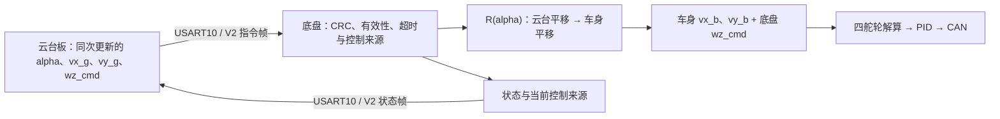

# 底盘与云台：坐标系及板间通信协议

本文约定：**云台板向底盘板发送云台相对角 `alpha`、平移速度 `vx/vy` 和底盘旋转角速度 `wz`；平移正方向以云台朝向为准。**

> **实现状态（2026-10-13）**：当前固件已实现 V1 的相对角接收、遥控坐标转换及底盘状态回传；尚未实现云台板下发平移/旋转速度。本文第 4～7 节定义的 **V2、16 字节协议是待实现的接口设计**，不能直接发给现有固件使用。本次只整理文档，不修改控制代码。

## 1. 两块板分别负责什么

| 云台控制板 | 底盘控制板 |
| --- | --- |
| 获取遥控/决策速度，形成 `vx_g、vy_g、wz_cmd` | 校验报文并判断控制来源、有效性和超时 |
| 从 yaw 轴反馈计算相对车头角 `alpha` | 将云台坐标速度转换成车身坐标速度 |
| 将同次更新的角度、速度放在一帧中发送 | 按车身速度解算四组舵轮，执行 PID、限速和电机保护 |
| 接收底盘状态，用于判断链路及控制是否生效 | 回传 IMU 角速度、指令有效性及当前控制来源 |

`wz_cmd` 是**底盘**旋转角速度指令，不是云台 yaw 电机速度，不是相对角变化率 `d(alpha)/dt`。



## 2. 坐标系图与正方向

### 2.1 车身坐标系 B

**俯视车辆**，车头固定在图的上方。`+X_b` 向车头、`+Y_b` 向车左、`+Z_b` 向上；正 `wz` 为俯视逆时针。位置原点取底盘中心。

```text
                         车头 / +X_b
                              ↑
             左前 FL          │          右前 FR
                 ●            │            ●
                              │
     车左 / +Y_b ←──────────── O
                              ⊙ +Z_b（朝观察者）
                        ↺ 正 wz：逆时针
                 ●                         ●
             左后 BL                     右后 BR
                         车尾 / -X_b
```

车身坐标随底盘一起旋转；在场地中车头转到哪里，`+X_b` 就指向哪里。

### 2.2 云台参考坐标系 G

`+X_g` 是云台朝向在底盘平面上的投影，`+Y_g` 是云台左侧。这里仅使用 **yaw**，不把云台 pitch 引入平面速度。为表达底盘中心的速度，两套坐标均画在底盘中心；云台提供方向基准，不要求 yaw 轴位于底盘中心。

定义 **`alpha`：从车身 `+X_b` 转到云台 `+X_g` 的有符号角，俯视逆时针为正。**

```text
alpha = 0°：云台朝车头                  alpha = +90°：云台朝车左

          +X_b、+X_g ↑                              +X_b ↑
                    │                                   │
   +Y_b、+Y_g ←───── O                     +Y_b、+X_g ←─ O
                                                        │
                                                        ↓ +Y_g
                                             从 ↑ 转到 ← 为 +90°
```

```text
alpha = -90°：云台朝车右                alpha = ±180°：云台朝车尾

          +X_b、+Y_g ↑                              +X_b ↑
                    │                                   │
          +Y_b ←─── O ───→ +X_g                +Y_b ←── O ───→ +Y_g
                                                        │
                                                        ↓ +X_g
```

| 量 | 正方向 / 含义 | 单位 |
| --- | --- | --- |
| `vx_g`，报文中的 `vx` | 沿云台朝向前进 | m/s |
| `vy_g`，报文中的 `vy` | 向云台左侧平移 | m/s |
| `wz_cmd`，报文中的 `wz` | 底盘俯视逆时针旋转 | rad/s |
| `alpha` | 云台相对车头的 yaw，逆时针为正 | rad |
| `vx_b / vy_b` | 转换后的车身向前 / 向左速度 | m/s |

相对角通常从 yaw 轴编码器得到：

```text
alpha = wrap_to_pi(安装方向符号 × (电机角度 - 朝车头时的零位角度) / 总传动比)
```

总传动比定义为“电机转角 / yaw 轴转角”；直接测量输出轴时为 1。若电机侧有减速机构，应先使用连续角度计算输出轴角度，再包裹到 `[-pi, pi]`。机械零位或传动关系未确认时，不发送“角度有效”标志。

### 2.3 小陀螺时的方向

若云台在场地中的朝向保持不变，底盘转动会使 `alpha` 连续变化；云台板必须持续发送实时相对角。

例如云台始终指向初始车头，底盘逆时针转过 90° 后，云台相对当前车头为 `alpha=-90°`。此时云台前进指令 `(1,0)` 转换成车身 `(0,-1)`，即车右，场地移动方向保持不变。

若云台自己转动，平移参考也随云台改变。这里不是固定场地坐标。

## 3. 坐标转换与舵轮解算

### 3.1 云台速度转换到车身速度

```text
vx_b = cos(alpha) × vx_g - sin(alpha) × vy_g
vy_b = sin(alpha) × vx_g + cos(alpha) × vy_g
wz_b = wz_cmd
```

这是二维旋转 `v_b = R(alpha) v_g`，**旋转角速度不交换轴、不取反**。转换只执行一次：云台板发送云台坐标速度，底盘负责转换，发送端不能先变成车身坐标后又作为云台坐标发送。

对云台前进指令 `(vx_g,vy_g)=(1,0)`：

| alpha | 车身 `(vx_b,vy_b)` | 实际方向 |
| --- | --- | --- |
| 0° | `(1,0)` | 车头 |
| +90° | `(0,1)` | 车左 |
| -90° | `(0,-1)` | 车右 |
| ±180° | `(-1,0)` | 车尾 |

以上是纯坐标转换结果，不含限速、舵向误差补偿等控制策略。V2 的 `vx/vy/wz` 定义为期望物理速度，接入建议默认只执行坐标转换与已有控制限幅；若还需要小陀螺额外降速，应作为明确配置说明，不能当作坐标变换的一部分。

**当前 V1 行为**：代码还保留了旋转中的 5 ms 预测及横向 0.4 / 纵向 0.3 平移缩放。V2 接入时需要单独处理这项行为，不能直接复用后假定发送 1 m/s 就得到 1 m/s 的解算输入。当前预测为 `alpha_used=alpha-yaw_rate_imu×0.005`，只补偿底盘转动，不预测云台自身转动。

### 3.2 四轮解算仍使用车身坐标

设半长为 `L`、半宽为 `W`，轮组顺序固定为左前、右前、左后、右后。

| 轮组 | 车身位置 `(x_i,y_i)` | 轮组 X 速度 | 轮组 Y 速度 |
| --- | --- | --- | --- |
| 左前 FL | `(+L,+W)` | `vx_b-wz_b×W` | `vy_b+wz_b×L` |
| 右前 FR | `(+L,-W)` | `vx_b+wz_b×W` | `vy_b+wz_b×L` |
| 左后 BL | `(-L,+W)` | `vx_b-wz_b×W` | `vy_b-wz_b×L` |
| 右后 BR | `(-L,-W)` | `vx_b+wz_b×W` | `vy_b-wz_b×L` |

```text
轮速 = sqrt(轮组X速度² + 轮组Y速度²)
舵角 = atan2(轮组Y速度, 轮组X速度)  // 相对车头，逆时针为正
```

随后由本车零位和安装符号映射到电机角度，再执行最短转角、驱动反向、cos³ 补偿和限速。

## 4. 串口接线与传输约定

使用底盘 **USART10 / huart10，921600 baud，8N1，无流控**。

```text
云台板（UART 编号按其工程选择）               底盘板 USART10

TX ───────────────────────────────────────→ PE2 / RX
RX ←─────────────────────────────────────── PE3 / TX
GND ─────────────────────────────────────── GND
```

图中是 MCU UART 信号，板上接口位置和是否经过收发器需看板卡标识；RS485 的 A/B 不能直接当成 TX/RX。

- 云台控制帧建议每 **5～10 ms** 更新一次。
- 底盘状态帧建议每 **10 ms** 发送一次，发送忙时可跳过。
- 所有多字节数值为小端，带符号数使用二进制补码。
- 不使用 C 结构体直接 `memcpy` 上线，按字节偏移打包，避免填充、枚举大小等差异。

## 5. V2：云台 → 底盘控制帧（待实现）

**固定 16 字节**。相对角与三轴速度放在同一帧，接收端必须校验整帧后一次性更新完整指令。

| 字节索引（从 0 开始） | 字段 | 类型 | 说明 |
| --- | --- | --- | --- |
| 0 | SOF0 | uint8 | `0xA5` |
| 1 | SOF1 | uint8 | `0x5A` |
| 2 | version | uint8 | `0x02` |
| 3 | type | uint8 | `0x01`，完整控制指令 |
| 4 | sequence | uint8 | 每个新鲜控制样本递增，255 后回到 0 |
| 5 | flags | uint8 | 见下表；正常控制为 `0x03` |
| 6～7 | alpha_mrad | int16 LE | 云台相对角 ×1000 |
| 8～9 | vx_mmps | int16 LE | 云台前方速度 ×1000 |
| 10～11 | vy_mmps | int16 LE | 云台左方速度 ×1000 |
| 12～13 | wz_mradps | int16 LE | 底盘逆时针角速度 ×1000 |
| 14～15 | crc16 | uint16 LE | 覆盖前 14 字节，低字节先发 |

### 5.1 标志与量程

| flags 位 | 为 1 时的含义 |
| --- | --- |
| bit0 | alpha 来自有效、新鲜且完成零位标定的反馈 |
| bit1 | 当前运动指令有效，允许执行 |
| bit2～7 | 保留，必须为 0 |

接入约定：正常运动必须同时置 bit0 和 bit1。任一为 0，当前由云台板控制时清零 **vx、vy、wz**；发送方同时将速度字段清零，推荐停机帧 flags=0。停机帧应在 CRC 正确后立即执行，即使序号与上次相同。

| 字段 | 线上量程 | 换算与接入约定 |
| --- | --- | --- |
| alpha | -3142～3142 mrad | `alpha=原始值×0.001 rad`；发送端先包裹到 `[-pi,pi]`，量化后允许 ±3142 |
| vx / vy | -32.768～32.767 m/s | 线上 int16 量程；接入建议沿用当前单轴 ±5 m/s 限幅 |
| wz | -32.768～32.767 rad/s | 线上 int16 量程；接入建议沿用当前 ±10 rad/s 限幅 |

单轴限幅不替代四轮合速度限幅。机械轮径和传动比仍须标定，不能仅凭字段单位认为实车速度已准确。

### 5.2 CRC16

两类 V2 帧使用相同校验：

```text
名称：CRC-16/CCITT-FALSE
多项式：0x1021
初始值：0xFFFF
输入/输出反射：否
最终异或：0x0000
校验范围：索引 0～13，共 14 字节
存放顺序：索引 14 为低字节，15 为高字节
```

不使用 UART7 的 XOR；当前 V1 的 CRC 只覆盖 8 字节，不能直接拿其固定长度函数计算 V2。

### 5.3 完整报文示例

以下均为 seq=7。数值是云台坐标指令，十六进制报文含 CRC：

| 场景 | `(alpha,vx,vy,wz)`，单位 rad / m/s / rad/s | flags |
| --- | --- | --- |
| 云台朝车头，向前 1 m/s | `(0,1,0,0)` | 03 |
| 云台朝车头，向左 1 m/s | `(0,0,1,0)` | 03 |
| 云台朝车左，沿云台前方 1 m/s | `(1.571,1,0,0)` | 03 |
| 沿云台前方 1 m/s，同时底盘逆时针 2 rad/s | `(0,1,0,2)` | 03 |
| 撤销控制并停车 | `(0,0,0,0)` | 00 |

```text
向前：
A5 5A 02 01 07 03 00 00 E8 03 00 00 00 00 52 AF

向左：
A5 5A 02 01 07 03 00 00 00 00 E8 03 00 00 83 9F

云台朝车左，沿云台前方运动：
A5 5A 02 01 07 03 23 06 E8 03 00 00 00 00 6A BD

边前进边逆时针旋转：
A5 5A 02 01 07 03 00 00 E8 03 00 00 D0 07 92 CA

停机：
A5 5A 02 01 07 00 00 00 00 00 00 00 00 00 BE EA
```

### 5.4 Python 打包参考

这段代码生成 V2 报文，用于云台发送端移植或串口调试；当前固件尚不能执行该报文。

```python
import binascii
import math
import struct


def pack_gimbal_control(alpha, vx, vy, wz, sequence, enabled=True, yaw_valid=True):
    if not isinstance(sequence, int) or not 0 <= sequence <= 255:
        raise ValueError("sequence must be uint8")
    flags = int(bool(yaw_valid)) | (int(bool(enabled)) << 1)
    if flags != 3:
        # 任一有效性不足时不携带运动量。
        alpha = vx = vy = wz = 0.0
    if not all(math.isfinite(v) for v in (alpha, vx, vy, wz)):
        raise ValueError("all values must be finite")
    alpha = math.remainder(alpha, 2 * math.pi)
    raw = [round(v * 1000) for v in (alpha, vx, vy, wz)]
    if any(v < -32768 or v > 32767 for v in raw):
        raise ValueError("value exceeds int16 range")
    payload = struct.pack("<6B4h", 0xA5, 0x5A, 2, 1, sequence, flags, *raw)
    crc = binascii.crc_hqx(payload, 0xFFFF)
    return payload + struct.pack("<H", crc)


frame = pack_gimbal_control(0.0, 1.0, 0.0, 0.0, sequence=7)
assert frame.hex(" ").upper() == "A5 5A 02 01 07 03 00 00 E8 03 00 00 00 00 52 AF"
```

同一控制样本包含角度与速度，但“同帧”不能保证传感器本身是新鲜的。发送端必须检查角度和上游速度指令的来源是否超时；不能把冻结数据配上递增序号伪装成新样本。

## 6. V2：底盘 → 云台状态帧（待实现）

同样固定 **16 字节**，version=`0x02`、type=`0x02`。它是周期状态，不代表电机已经达到指令速度。

| 字节索引 | 字段 | 类型 / 说明 |
| --- | --- | --- |
| 0～1 | 帧头 | A5 5A |
| 2 | version | 02 |
| 3 | type | 02 |
| 4 | sequence | 底盘状态自身的递增序号 |
| 5 | flags | 下表状态位 |
| 6～7 | measured_wz_mradps | int16 LE，IMU 实测底盘角速度 ×1000；IMU 无效则填 0 |
| 8～9 | received_alpha_mrad | int16 LE，最近接受的 V2 控制帧角度；过期可以保留，必须结合 flags |
| 10 | last_control_sequence | 最近接受的 V2 控制帧序号；未收到时为 0，结合 bit4 区分 |
| 11 | control_source | 0=停车/无控制源，1=底盘本地 DT7，2=UART7，3=USART10 云台板 |
| 12～13 | reserved | uint16 LE，固定 0 |
| 14～15 | crc16 | 前 14 字节的 CRC，小端 |

| flags 位 | 含义 |
| --- | --- |
| bit0 | IMU 角速度有效 |
| bit1 | 最近的 V2 相对角有效且控制帧龄不超过 50 ms |
| bit2 | 最近的 V2 控制指令有效且帧龄不超过 50 ms |
| bit3 | 四轮驱动的舵向对齐联锁已放行 |
| bit4 | 至少接受过一帧 V2 控制帧；超时后仍保留 |
| bit5～7 | 保留，必须为 0 |

`control_source=3` 才表示云台板实际获得控制权；收到报文、bit2 有效和获得控制权不是同一件事。`measured_wz` 不是命令回显；暂不回传实测 vx/vy，因为当前工程尚无对应的平移里程计。

## 7. V2 控制时序、超时与接入策略（待实现）

### 7.1 收发处理

1. 云台每 5～10 ms 获取新鲜角度和速度指令，递增序号并发送完整控制帧。
2. 底盘按字节流重同步，支持 DMA 拆包、多帧连续接收；核对帧头、版本、类型、CRC、flags 保留位及角度范围。
3. 将 alpha/vx/vy/wz/flags/序号/本地接收时间作为一个一致快照更新。CRC 错误或字段非法不更新快照、不刷新超时。
4. 正常重复序号不刷新超时；正确停机帧立即撤销运动。255→0 是合法序号回绕。
5. 控制循环按选定控制源读取快照，云台来源执行 `R(alpha)` 后送入四轮解算。
6. 云台控制帧超过 **50 ms** 未更新时，云台控制来源的 **vx/vy/wz 全部清零**；恢复后必须是新鲜有效的控制帧，并重新满足电机反馈和舵向对齐条件。

这里与旧 V1 不同：V1 只传角度，角度丢失时只禁止遥控平移；V2 同时承载旋转指令，因此整条控制链路超时时不能继续保留上一次 wz。

### 7.2 推荐的控制来源接入方式

现有代码是“本地 DT7 优先，DT7 离线时 UART7 接管”，还没有 USART10 速度控制分支。

V2 接入建议将 USART10 与 UART7 作为明确配置的两种运行来源：云台控制模式选择 USART10，独立导航模式选择 UART7；本地 DT7 可保留为调试接管。**不能叠加两个来源的速度，也不能因云台链路超时就自动执行另一来源的旧命令。** 这是接入建议，具体模式选择尚未写入当前固件。

UART7 继续采用既有 9 字节 `AA 06 vx vy wz XOR` 协议，且其 vx/vy 是**车身前/左坐标**；USART10 V2 是**云台前/左坐标**。两者不可按同一坐标含义直接复用。

## 8. 当前 V1 与 V2 的差异、代码位置

| 项目 | 当前 V1 已实现 | 本文 V2 待实现 |
| --- | --- | --- |
| 长度 / 版本 | 固定 10 字节 / 01 | 固定 16 字节 / 02 |
| 云台 → 底盘 | 仅相对角 alpha 与有效标志 | alpha + vx + vy + wz + 有效/使能标志 |
| 速度来源 | 本地 DT7 或 UART7 | 增加 USART10 云台板控制来源 |
| CRC 范围 | 前 8 字节 | 前 14 字节 |
| 类型 01 数据 | int16 alpha | 4 个 int16：alpha、vx、vy、wz |
| 类型 02 数据 | 底盘 IMU 角速度与状态位 | IMU 角速度、接收角度、控制序号、来源及状态位 |
| 相对角链路超时 | 50 ms；遥控平移置零 | 50 ms；云台来源完整运动指令置零 |

V1 帧格式：`A5 5A 01 type seq flags value_lo value_hi crc_lo crc_hi`。V1 的类型 01 中 flags bit0 表示角度有效；类型 02 中 bit0=IMU 就绪、bit1=角度有效且新鲜、bit2=UART7 控制、bit3=驱动放行。**V1 与 V2 的状态位不能混用。**

当前 `BoardLinkDecode()` 仅接受 version=1，长度常量为 10；它会拒绝 V2 数据。迁移时必须同步两块板的版本、长度、打包、解析和控制源处理，不能只把发送缓冲区加长。

- [alg_board_link.h](../Skywalker/Algorithm/Inc/alg_board_link.h)、[alg_board_link.c](../Skywalker/Algorithm/Src/alg_board_link.c)：现有 V1、无 HAL 依赖的编解码。
- [app_gimbal_link.h](../Skywalker/Application/Inc/app_gimbal_link.h)、[app_gimbal_link.c](../Skywalker/Application/Src/app_gimbal_link.c)：现有 V1 角度接收快照、有效性和超时。
- [app_robot.c](../Skywalker/Application/Src/app_robot.c)：USART10 初始化、云台坐标转换、控制来源选择及状态发送。
- [communication.md](../communication.md)：UART7 车身速度协议。

当前工作区没有云台板工程。历史 `build/GimbalLink/h7_framework.elf` 对应 V1，**不支持本文 V2 速度帧**。本文报文示例可用 Python 打包参考校验；这不代表 V2 固件已实现或实车已验证。

## 9. 本工程全部串口

以下是 MCU 引脚配置，不代表板上插座一定直接引出了相同电平。

| 外设 / 句柄 | TX | RX | 波特率 / 格式 | 当前用途 |
| --- | --- | --- | --- | --- |
| USART1 / huart1 | PA9 | PA10 | 921600 / 8N1 | GM6020 FireWater；启用裁判系统时复用为裁判通信 |
| USART2 / huart2 | PD5 | PD6 | 1000000 / 8N1 | 应用层空闲，RS485，DE=PD4 |
| USART3 / huart3 | PD8 | PD9 | 1000000 / 8N1 | 应用层空闲，RS485，DE=PB14 |
| UART5 / huart5 | PC12（未启用发送） | PD2 | 100000 / 8E2 | DT7/SBUS 接收 |
| UART7 / huart7 | PE8 | PE7 | 921600 / 8N1 | 上位机车身速度 |
| USART10 / huart10 | PE3 | PE2 | 921600 / 8N1 | 云台相对角 V1 与底盘状态，计划升级为本文 V2 |

USART10 原用于视觉收发，当前 `kRobotVisionEnabled=0`、`kRobotGimbalLinkEnabled=1`；编译期禁止二者同时启用。
